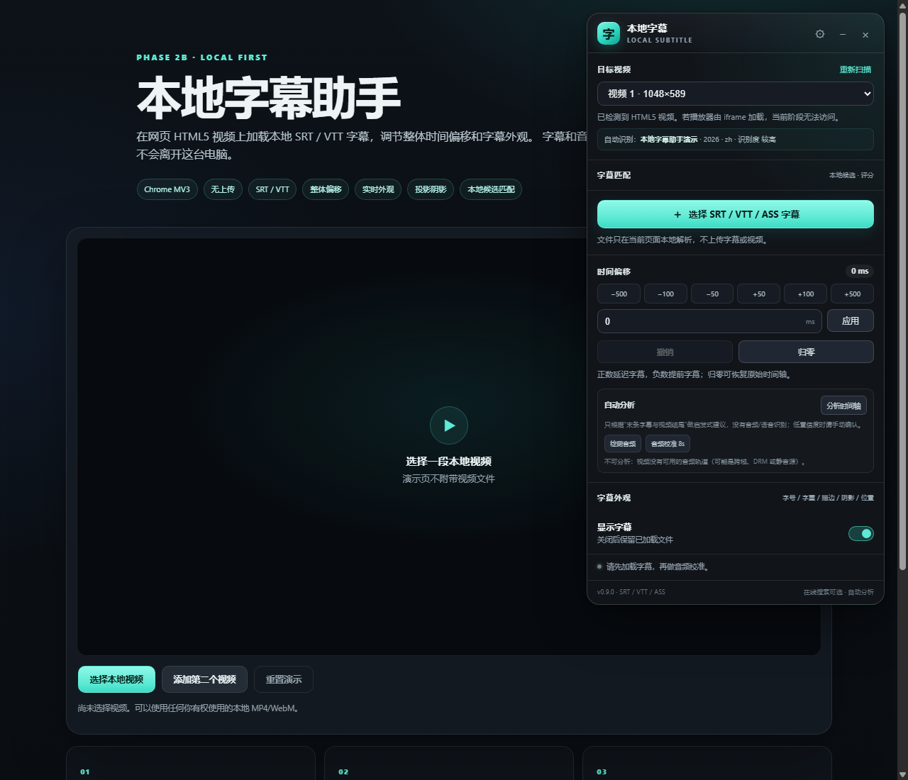
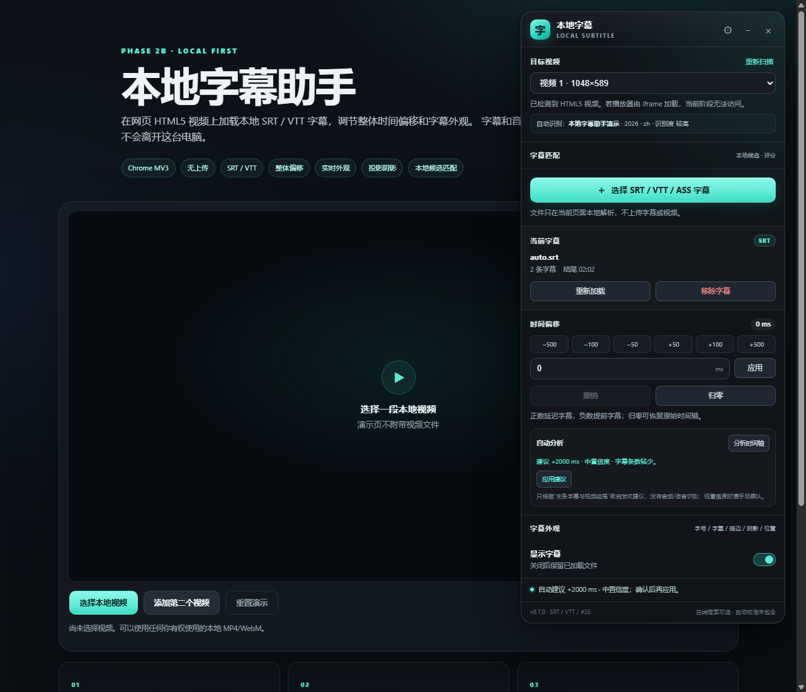
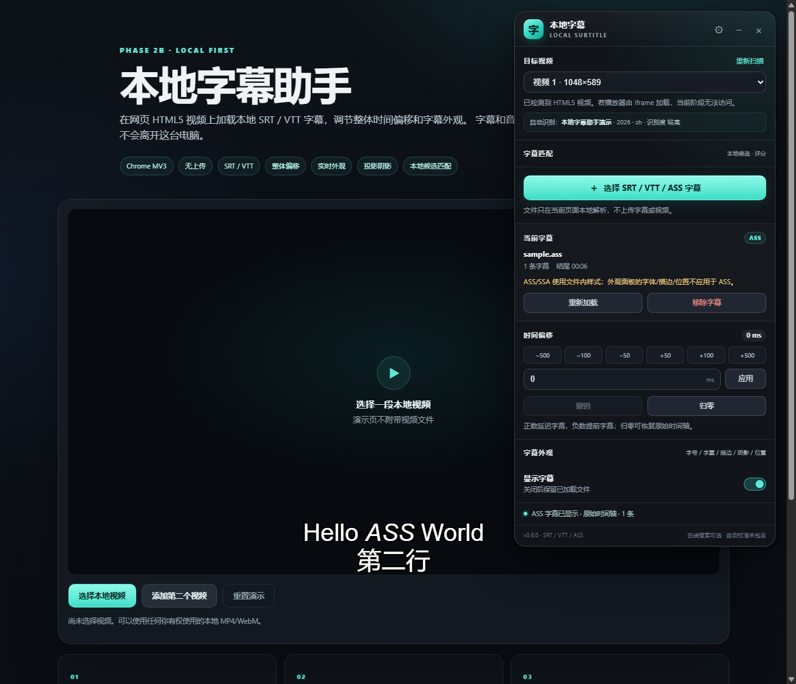
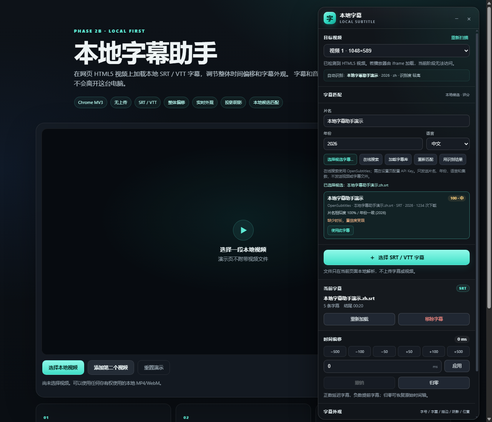
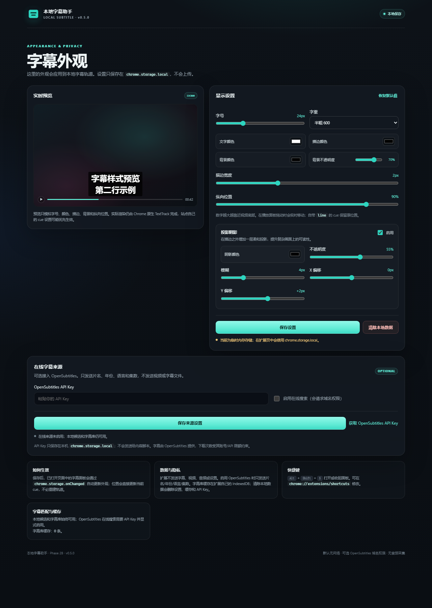
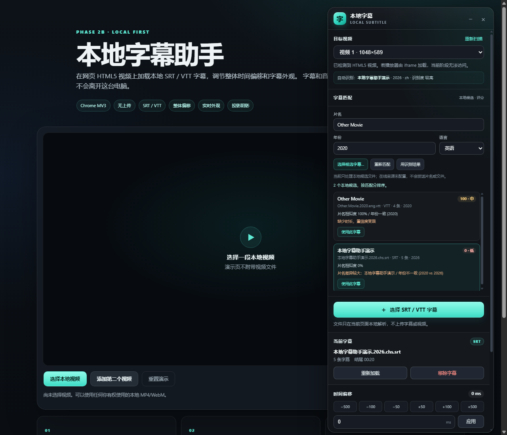
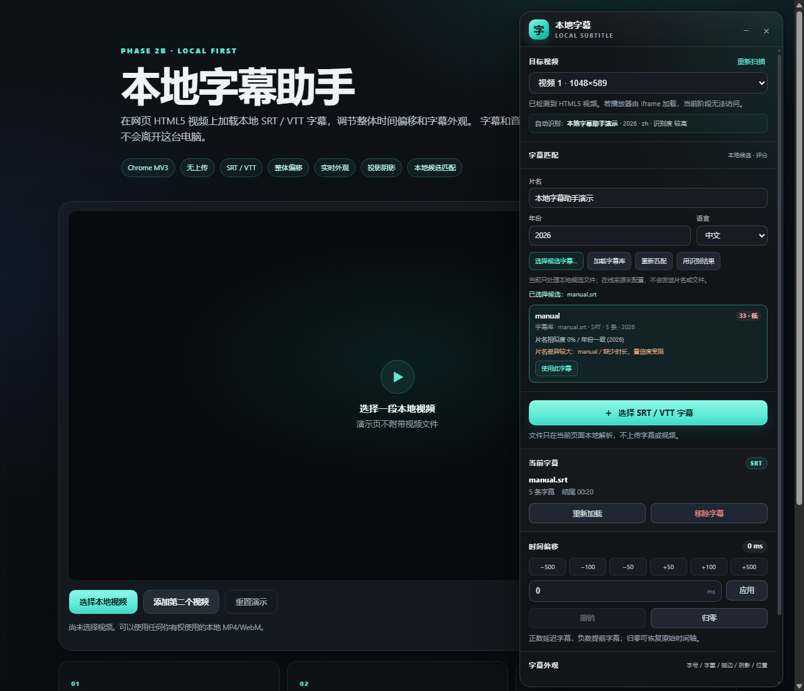

# 本地字幕助手（v0.9.11 RC · SRT / VTT / ASS）

一个本地优先的 Windows Chrome Manifest V3 扩展：在网页 HTML5 `<video>` 上加载本地
SRT / VTT / ASS 字幕，支持整体时间偏移、多视频选择、动态页面检测、轨道清理和实时外观设置。

> 当前版本：`0.9.11`（1.0.0 发布候选）。
> 已完成第一阶段、第二阶段 A，以及 Phase 2B：
> - 外观 2.0：面板放大、位置拖动实时生效、字重、投影阴影；
> - 本地影片元数据识别、手动片名/年份/语言；
> - 本地候选字幕列表、匹配评分、置信度和理由；
> - 扩展 IndexedDB 字幕库、最近字幕复用、清除缓存；
> - **ASS/SSA 解析与覆盖层渲染**（常用样式/定位子集）；
> - **自动偏移分析**（启发式尾锚定，低置信度需确认）；
> - **可选 OpenSubtitles 在线搜索与下载**，默认关闭，需配置 API Key。
>
> 默认没有网络请求；只有你在设置页填写 API Key 并显式启用后，
> 才会把片名、年份、语言、集数发给 OpenSubtitles。
> 不发送视频、音频或字幕文件。
>
> 功能与用法：[docs/FINAL.md](docs/FINAL.md)；版本历史：[docs/CHANGELOG.md](docs/CHANGELOG.md)；
> v0.9.11 验收报告：[docs/ACCEPTANCE-0.9.11.md](docs/ACCEPTANCE-0.9.11.md)。
















## 目录

- [当前状态](#当前状态)
- [安装（Windows Chrome）](#安装windows-chrome)
- [使用](#使用)
- [字幕外观与设置](#字幕外观与设置)
- [字幕匹配（本地候选）](#字幕匹配本地候选)
- [本地演示页面](#本地演示页面)
- [目录结构](#目录结构)
- [架构边界](#架构边界)
- [测试](#测试)
- [数据与隐私](#数据与隐私)
- [行为边界](#行为边界)
- [已知限制与未验证项](#已知限制与未验证项)
- [版本与完整版](#版本与完整版)
- [下一阶段计划](#下一阶段计划)

## 当前状态

### Phase 1 已完成

- Manifest V3，无构建步骤，可直接加载。
- 通过工具栏图标或 `Alt+Shift+S` 按需注入当前标签页（`activeTab`）。
- SRT/VTT/ASS/SSA 本地读取；BOM、UTF-16LE/BE、UTF-8 严格解码、GB18030 回退。
- SRT 可选序号、CRLF、毫秒、多行对白、空行；非法时间戳/反向时间轴报错。
- SRT → WebVTT；VTT cue id/settings；`STYLE`/`REGION` 尽力保留。
- 原生 `<track>` 注入；新轨道加载成功后才移除旧轨道。
- 每次替换、移除、页面卸载时回收 Blob URL。
- 多视频选择；`MutationObserver` 处理 SPA 视频变化。
- 视频销毁/切换时清理旧轨道，恢复网页原生 TextTrack 模式。
- 整体偏移（±1 小时）、快捷微调、数字输入、撤销、归零。
- 启用/禁用、重新加载轨道、移除字幕。
- Shadow DOM 中文面板：拖动、折叠、关闭、窄视口约束、全屏容器适配。

### Phase 2A 已完成

- `chrome.storage.local` 设置持久化（新增 `storage` 权限，仍无 `host_permissions`）。
- 外观设置：字号、文字颜色、描边颜色与宽度、背景颜色与不透明度、纵向位置。
- **平滑轮廓**：2px 用 24 向环形阴影，4px 以上用 32 向，附加 0.12–0.4px 微模糊。
- 描边宽度支持 0.5px 步进（0–6px），便于细调。
- 独立选项页：`options/options.html`，支持预览、保存、恢复默认值、清除本地数据。
- 设置修改通过 `chrome.storage.onChanged` 同步到已打开面板。
- 原生 `::cue` 样式：优先由 Service Worker 调用
  `chrome.scripting.insertCSS(..., origin: 'USER')`；失败时退回页面内 `<style>`。

### v0.3.0：外观 2.0 + Phase 2B 起步

- 面板宽度从 360px 放大到 **420px**，外观控件更大、两列布局。
- **位置拖动实时生效**：直接更新当前 `TextTrack.cues` 的 `line`，
  不重建 `<track>`、不创建新 Blob；松开后才保存设置。
- 新增字重 400–800。
- 新增独立投影阴影：启用、颜色、不透明度、模糊、X/Y 偏移。
- 关闭阴影时相关控件自动禁用，并立即从 CSS 中移除阴影层。
- 新增 `matching/metadata-extractor.js`：
  - 本地读取 JSON-LD / OG / 标题 / 视频时长；
  - 年份、时长、语言、季/集、发布文件名清洗；
  - 面板显示“自动识别”影片信息，低置信度不显示；
  - 不上传。
- 新增 `matching/candidate-ranker.js`：
  - 片名、年份、时长、语言、集数加权评分；
  - 返回覆盖率、置信度、匹配理由和冲突项；
  - 缺字段不会被当作满分。
- 新增 `matching/subtitle-provider.js`：
  - Provider 注册、校验、搜索和下载路由；
  - 失败隔离、禁用 Provider 不调用；
  - **无内置网络 Provider、无 API 地址**。

### v0.4.0：本地候选匹配 UI

- 面板新增可折叠「字幕匹配」区：
  - 片名、年份、语言可手动修正；
  - 自动元数据预填；
  - 「用识别结果」一键恢复识别值；
  - 选择多个本地 SRT/VTT/ASS 作为候选；
  - 候选按匹配分排序，显示分数、置信度、匹配理由和冲突项；
  - 点击「使用此字幕」直接加载，不重复读文件。
- 新增本地候选评分流程：
  - 候选来自本地文件，完全离线；
  - 关键词/年份/语言/时长/集数评分；
  - 缺字段时显示“置信度受限”；
  - 不伪造在线搜索结果。
- 面板明确标注“在线来源未配置，不会发送片名或文件”。

### v0.4.1：本地字幕库与缓存

- 新增扩展源 IndexedDB 字幕库 `storage/subtitle-cache.js`：
  - 字幕文本、文件名、格式、cue 数、标题、年份、语言；
  - 最多 50 条，按最近使用排序；
  - 只保存本扩展自己的数据，不写宿主网页 origin。
- content script 通过 service worker 缓存消息访问 IndexedDB：
  - `PUT / LIST / GET / TOUCH / CLEAR / COUNT`；
  - 避免 content script 把字幕写进网页 origin 的 IndexedDB。
- 面板新增「加载字幕库」：
  - 最近字幕作为候选参与同一套评分；
  - 候选卡片显示“字幕库”来源；
  - 点击后从缓存恢复并直接显示。
- 手动加载字幕、应用候选后自动缓存。
- 选项页显示缓存条数；
- 「清除本地数据」同时删除设置和字幕缓存。
- 测试增加到 **82**。

### v0.5.0：OpenSubtitles 在线来源

- 可选 OpenSubtitles REST API v1：
  - 设置页填写 API Key 并显式启用；
  - 首次启用请求 `https://*.opensubtitles.com/*` 可选域名权限；
  - 默认关闭，未配置时在线搜索只显示说明。
- 在线搜索：
  - 只发送片名、年份、语言、季/集；
  - 结果进入同一套候选评分；
  - 显示 OpenSubtitles 来源、文件名、格式、下载次数；
  - 点击后才下载字幕文本，下载成功后写入本地字幕库。
- API Key 只保存在 `chrome.storage.local`，不进入 content script；
  搜索/下载由 service worker 代理。
- 下载内容按 UTF-8 解析；ZIP 响应会明确报错，不会静默失败。
- 清除本地数据会同时删除 API Key、缓存和可选域名权限。
- 新增测试，总数 **89**。

### v0.5.1：选项页入口修复

- 面板头部新增齿轮 `⚙` 按钮，直接调用扩展选项页。
- 原「字幕外观 → 更多设置」入口保留。
- README 更新四种打开方式：
  - 面板齿轮；
  - 外观底部「更多设置」；
  - `chrome://extensions/` → 详细信息 → 扩展程序选项；
  - 右键工具栏图标 →「选项」。
- 如果看不到齿轮，说明页面仍是旧注入脚本，需要重新加载扩展后刷新网页。
- 修复原生 `fetch` 被当作对象方法调用导致的 `Illegal invocation`。
- 权限被拒时仍保存 API Key，但保持“未启用”；设置页新增「测试连接」。
- 测试总数 **90**。

### v0.5.2：最终交付版

- 修复 Service Worker `importScripts` 相对路径错误：
  - 之前 `shared/namespace.js` 按 worker 脚本路径解析，实际请求 `background/shared/namespace.js`；
  - 结果缓存/在线来源模块未加载，报“在线来源模块未加载”；
  - 现在使用 `chrome.runtime.getURL(...)` 完整扩展 URL。
- 新增 Service Worker import URL 回归测试。
- 测试总数 **91**。
- 最终功能与用法见 [docs/FINAL.md](docs/FINAL.md)，版本历史见 [docs/CHANGELOG.md](docs/CHANGELOG.md)。

### v0.6.0：ASS/SSA 覆盖层

- 新增 `subtitles/ass-parser.js`：
  - `[Script Info]`、`[V4 Styles]`、`[V4+ Styles]`、`[Events]`；
  - 动态 `Format:`、对白内逗号、`\N` 换行；
  - 样式、字号、颜色、描边、阴影、对齐、边距、层级。
- 新增 `subtitles/ass-text.js`：
  - `\an`、`\pos`、`\fs`、`\b`、`\i`、颜色、`\bord`、`\shad`、`\r`；
  - 未知标签忽略，不显示成乱码。
- 新增 `content/ass-overlay.js`：
  - 覆盖层跟随视频位置/尺寸；
  - 逐帧按 `currentTime - offset` 显示；
  - 支持 9 宫格对齐、`\pos`、多行、描边、阴影；
  - 不使用原生 `<track>`，因此不破坏 SRT/VTT 路径。
- 偏移、启用/禁用、移除、字幕库、在线下载均可用于 ASS。
- ASS 使用文件内样式；外观面板的字体/描边/位置不覆盖 ASS。
- 测试总数 **98**；浏览器烟测验证 ASS 文本、样式、偏移、移除。
- 验收报告：[docs/ACCEPTANCE-0.6.0.md](docs/ACCEPTANCE-0.6.0.md)。

### v0.7.0：自动偏移分析

- 新增 `alignment/offset-estimator.js`：
  - 尾锚定：`videoDuration - lastCueEnd`；
  - 首条字幕越界时限制偏移；
  - 字条数、尾部距离、偏移大小计算评分；
  - 最高“中”置信度，不自动应用。
- 面板「自动分析」：
  - 分析时间轴；
  - 显示建议偏移、置信度、警告；
  - 应用建议进入现有偏移/撤销流程。
- 视频时长优先取 `<video>.duration`，否则用本地元数据时长。
- 测试总数 **103**；浏览器烟测 +2000 ms 建议并应用。
- 验收报告：[docs/ACCEPTANCE-0.7.0.md](docs/ACCEPTANCE-0.7.0.md)。

### v0.7.1：自动分析安全修复

- 尾差超过 **120 秒**时不再给出可应用的自动建议；
  直接提示“可能缺少片尾/彩蛋，请归零后手动校准”。
- 自动建议偏移超过 **120 秒**时同样拒绝。
- 面板不再显示「应用建议」按钮，避免一键把字幕推偏数分钟。
- 新增危险尾差回归测试。
- 测试总数 **104**。
- 验收报告：[docs/ACCEPTANCE-0.7.1.md](docs/ACCEPTANCE-0.7.1.md)。

### v0.8.0：自动时间轴安全分析 2.0

- 自动建议加入**首条/末条双锚点一致性**：
  - 首条字幕在开头、末条却差 29 秒时，拒绝而不是建议 +28.8 秒；
  - 首尾锚点冲突时提示手动校准。
- 尾差/自动偏移安全阈值从 120 秒收紧到 **10 秒**。
- 当前截图场景（视频 1:28:42、字幕末条 1:28:13、首条接近 0）不会出现 +28775ms 建议。
- 保留手动归零、±500 微调、数字输入。
- 测试总数 **106**。
- 验收报告：[docs/ACCEPTANCE-0.8.0.md](docs/ACCEPTANCE-0.8.0.md)。

### v0.9.5：标签页音频捕获（1.0 候选）

- 新增 `tabCapture` + `offscreen` 权限与 offscreen 音频采样。
- 面板新增「标签页音频 8s」：
  - 捕获当前标签页音频；
  - 仅本地分析；
  - 结果必须手动确认。
- 真实扩展已在 Edge 155 加载验证：Service Worker 模块、offscreen 生命周期、选项页正常。
- 标签页音频 E2E 尚未在真实站点验证；暂不发布 1.0.0。
- 测试总数 **110**。
- 验收报告：[docs/ACCEPTANCE-0.9.5.md](docs/ACCEPTANCE-0.9.5.md)。

### v0.9.6：多窗口鲁棒校准

- 40 秒采样拆成 5 个 8 秒窗口，独立估计后聚合。
- 新增活动检测与时间映射校验：
  - 噪声底 + 滞回阈值；
  - 窗口活动比例不足直接拒绝；
  - 暂停、拖动、倍速变化丢弃本次会话。
- 新增加权中位数、MAD、窗口跨度、分簇拒绝：
  - 有效窗口 <3 不输出；
  - MAD >0.5s 标记不稳定；
  - 窗口结果分簇不平均。
- 结果明确为**目标总偏移**，不是增量；应用即设置为该值。
- 高/中/低置信度；UI 显示有效窗口数、MAD。
- 测试总数 **116**。
- 验收报告：[docs/ACCEPTANCE-0.9.6.md](docs/ACCEPTANCE-0.9.6.md)。

### v0.9.7：逐窗口诊断

- 多窗口失败时输出可复制的诊断：
  - 窗口编号/媒体时间；
  - 每窗口偏移；
  - 第一/第二峰分数；
  - 音频活动比例、字幕活动比例；
  - MAD、有效窗口数；
  - 拒绝原因。
- 校准区新增「校准诊断」折叠面板和「复制诊断」。
- 不降低 MAD 阈值，不强行平均；先定位问题。
- 测试总数 **116**。
- 验收报告：[docs/ACCEPTANCE-0.9.7.md](docs/ACCEPTANCE-0.9.7.md)。

### v0.9.8：峰值质量与 MAD 语义修正

- 修正 MAD 语义：
  - 标准 MAD 围绕**未加权中位数**；
  - 目标残差 MAD 围绕**加权中位数**；
  - 两者都显示。
- 窗口先做峰值质量筛选：
  - `margin<0.03` 标记 `AMBIGUOUS_PEAK`；
  - 偏移贴近 ±15s 搜索边界标记 `SEARCH_BOUNDARY`；
  - 低置信度不再进入聚合。
- 诊断增加 median offset、target residual MAD、拒绝窗口分数/偏移。
- 不降低 MAD 阈值。
- 测试总数 **117**。
- 验收报告：[docs/ACCEPTANCE-0.9.8.md](docs/ACCEPTANCE-0.9.8.md)。

### v0.9.9：第二独立峰与时间映射诊断

- 每窗口输出：
  - audio sample start/end；
  - distinct second peak offset/score；
  - distinctMargin；
  - searchBoundaryHit；
  - mediaTimeDiscontinuity；
  - rejectReason。
- 第二峰会跳过最佳峰附近 1 秒的相邻搜索点。
- 仍保持最少 3 个有效窗口、peak margin 0.03、±15s 边界拒绝。
- 测试总数 **118**。
- 验收报告：[docs/ACCEPTANCE-0.9.9.md](docs/ACCEPTANCE-0.9.9.md)。

### v0.9.10：跨窗口候选共识

- 汇总每个窗口最多 8 个候选峰。
- ±1000ms 内候选合并成簇，按支持窗口数排序。
- 输出 offset/support/medianScore/secondOffset。
- 仅作为诊断；即使支持 3/5 仍不自动应用。
- 测试总数 **119**。
- 验收报告：[docs/ACCEPTANCE-0.9.10.md](docs/ACCEPTANCE-0.9.10.md)。

### v0.9.11：整段 40 秒全局相关性

- 在多窗口之外，额外输出整段 40 秒的 global 偏移/分数/第二独立峰。
- 仅诊断，不自动应用。
- 如果 global 也无唯一峰，停止用能量相关性调参，转文本级 ASR。
- 测试总数 **119**。
- 验收报告：[docs/ACCEPTANCE-0.9.11.md](docs/ACCEPTANCE-0.9.11.md)。

### v0.9.0：音频自动校准（实验）

- 新增 `content/audio-calibrator.js`：
  - `video.captureStream()` 读取音频轨；
  - 8 秒 RMS 采样；
  - 不接管/静音原视频音频。
- 新增 `alignment/audio-aligner.js`：
  - 音频能量与 cue 活动做相关性；
  - 搜索 ±15 秒偏移；
  - 静音/相关性不足会拒绝。
- 面板新增「检测音频」「音频校准 8s」：
  - 可分析性检测；
  - 采样后显示建议/置信度，确认后应用。
- **跨域、DRM、无音轨媒体会失败并回退手动校准。**
- 测试总数 **110**。
- 验收报告：[docs/ACCEPTANCE-0.9.0.md](docs/ACCEPTANCE-0.9.0.md)。

### 明确未实现

- 完整 libass 等价能力：`\move`、`\t`、卡拉 OK、矢量绘图、复杂旋转/裁剪。
- 可靠的音频/语音自动对齐、分段对齐；当前音频校准为实验功能。
- iframe 内视频、Shadow DOM 内视频、Canvas/DRM 播放器。
- 任意字体族安装依赖、任意二维定位/ASS 级特效。
- Android 端。

## 安装（Windows Chrome）

不需要 `npm install`，不需要打包。

1. 打开 Chrome，地址栏输入 `chrome://extensions/`。
2. 打开右上角 **开发者模式**。
3. 点击 **加载已解压的扩展程序**。
4. 选择这个目录（`manifest.json` 所在目录）：
   `C:\Users\skkkkl123\Desktop\smart-subtitle-extension`
5. 建议把「本地字幕助手」固定到工具栏。
6. 打开一个有普通 HTML5 `<video>` 的网页，点击扩展图标。

首次点击图标时，`activeTab` 才授予当前标签页访问权限；扩展不会在浏览网页时自动注入。
刷新网页后需要再次点击图标。快捷键为 `Alt+Shift+S`。

在线字幕是**可选**的：安装时不请求 OpenSubtitles 域名权限；只有在设置页勾选启用时，
Chrome 才会询问 `https://*.opensubtitles.com/*`。

> Chrome 不允许扩展向 `chrome://`、Chrome 应用商店、`devtools://` 等页面注入脚本。
> 这时图标会显示红色 `!` 徽标，鼠标悬停可看到原因。

### 打开设置页

- **方法一（最快）**：面板右上角齿轮 `⚙`，直接打开设置页。
- 方法二：面板「字幕外观」→ 底部「更多设置」。
- 方法三：`chrome://extensions/` → 本地字幕助手 → **详细信息** → **扩展程序选项**。
- 方法四：右键工具栏上的扩展图标 →「选项」。
- 设置只保存在 `chrome.storage.local`。

> 如果右上角没有齿轮，说明页面还在运行旧版内容脚本：
> 先到 `chrome://extensions/` 点扩展卡片上的「重新加载」，再刷新网页。

## 使用

1. 播放页面视频。
2. 点击扩展图标，面板出现在右上角。
3. 「目标视频」选择正确的 `<video>`；多视频页面可下拉切换。
4. 点击「选择 SRT / VTT / ASS 字幕」，选择本地文件。
5. 使用 `−500 / −100 / −50 / +50 / +100 / +500` 或输入毫秒数后点「应用」调整整体偏移。
   - 正数：字幕延迟。
   - 负数：字幕提前。
   - 「撤销」回到上一个偏移。
   - 「归零」恢复字幕文件的原始时间轴。
6. 打开「字幕外观」调整字号、字重、颜色、描边、阴影和位置；拖动位置滑块时字幕实时移动。
7. 「显示字幕」开关只切换显示，不移除已加载文件。
8. 「重新加载」重新生成轨道；「移除字幕」清理轨道和 Blob URL。
9. 面板可拖动标题栏移动，可用标题栏右侧按钮折叠/关闭。关闭后再次点击扩展图标可打开。
10. 「目标视频」下方会显示本机自动识别的影片信息（标题、年份、时长、语言、识别度）；
    低于 0.5 的识别度不会显示，避免把普通页面标题当成电影。

## 自动分析偏移

1. 先加载字幕并选择视频。
2. 「时间偏移」→「自动分析」→「分析时间轴」。
3. 面板显示建议偏移、置信度和警告。
4. 确认后点「应用建议」；可「撤销」回退。

当前使用**首条/末条双锚点一致性**做启发式分析；尾差超过 10 秒会直接拒绝，不提供应用按钮：

- 不是音频/语音识别；
- 视频时长未知时无法分析；
- 片尾/彩蛋、缺少结尾字幕会显著影响结果；
- 最多只给“中”置信度，且不会自动应用；
- 低置信度时请手动微调。

### 音频校准（实验）

- 「检测音频」：检查视频是否有可捕获音轨。
- 「音频校准 8s」：播放 8 秒，采样音频能量，与字幕 cue 活动做相关性。
- 只搜索 ±15 秒，静音/相关性不足会拒绝。
- 跨域、DRM、无音轨媒体通常不可用，请手动校准。
- 不会接管或静音原视频音频；结果必须手动确认。

## 字幕外观与设置

面板内的「字幕外观」区可直接调整：

- 字号：14–48 px。
- 字重：400 / 500 / 600 / 700 / 800。
- 文字颜色、描边颜色、背景颜色。
- 描边宽度：0–6 px，支持 0.5px 步进。
- 描边采用环形采样而不是 4 个角的硬阴影，宽描边会自动提高采样密度。
- 背景不透明度：0–95%。
- 纵向位置：60–96%。数字越大越靠近视频底部。
- **拖动位置时字幕实时移动**，不会反复重建轨道。
- 投影阴影：启用、颜色、不透明度、模糊、X/Y 偏移。
- 「恢复默认外观」立即恢复并保存。
- 「更多设置」打开完整选项页。

设置页额外提供更大的实时预览、保存、恢复默认值和清除所有 `smartSubtitle.*` 本地数据。

限制说明：

- Chrome 原生 `::cue` 只支持部分 CSS 属性；这里使用字号、字重、颜色、背景、文字阴影等常见子集。
- 若 VTT cue 自带 `line` 设置，纵向位置滑块不会覆盖它。
- 实时位置通过修改当前 TextTrack cue 的 `line` 实现；以后重载轨道时会重新写入生成的 VTT。
- 站点自己的 cue 样式、视频尺寸、浏览器版本都可能影响最终视觉效果。
- 目前没有自定义字体族或任意二维定位。

## 字幕匹配（本地候选）

面板「字幕匹配」区当前只处理本地候选文件，不访问网络：

1. 选择目标视频；元数据会自动填入片名、年份、语言。
2. 可手动修正这三个字段；「用识别结果」恢复自动识别值。
3. 点「选择候选字幕…」，一次选择多个本地 SRT/VTT/ASS。
4. 候选会按片名、年份、语言、时长（若元数据可用）和集数评分；
   显示分数、置信度、匹配理由与冲突项。
5. 点「使用此字幕」加载候选，后续偏移和外观设置照常使用。

评分权重：片名 0.50、年份 0.18、时长 0.20、语言 0.07、集数 0.05。
本地候选通常没有可靠视频时长，因此会显示“缺少时长，置信度受限”，不会把
缺字段当成满分。

### 字幕库

- 手动加载或应用候选后，字幕会自动进入扩展自己的 IndexedDB 字幕库。
- 在「字幕匹配」里点「加载字幕库」，缓存条目会作为候选参与同一套评分。
- 候选卡片会标记「字幕库」；点击后从缓存恢复并显示。
- 最多保留 50 条，按最近使用排序。
- 缓存通过 service worker 读写，避免 content script 使用宿主网页 origin 的 IndexedDB。
- 选项页「清除本地数据」会同时删除设置、字幕缓存和 OpenSubtitles API Key。

### 在线搜索（OpenSubtitles，可选）

1. 在 [OpenSubtitles](https://www.opensubtitles.com/) 注册并获取 API Key
   （参考 [API 文档](https://opensubtitles.stoplight.io/docs/opensubtitles-api)）。
2. 打开选项页，在「在线字幕来源」填写 API Key。
3. 勾选「启用在线搜索」并保存；浏览器会请求 `https://*.opensubtitles.com/*` 权限。
4. 在设置页点「测试连接」；成功会显示返回的测试结果条数，失败会显示具体原因。
5. 回到面板「字幕匹配」，点击「在线搜索」。
6. 结果会和本地候选、字幕库一起评分；点击「使用此字幕」才下载正文。
7. 下载成功后自动进入本地字幕库。

只发送片名、年份、语言、季/集，不发送视频、音频、字幕文件。
API Key 不进入内容脚本；网络请求由 Service Worker 完成。
如果没有 API Key 或未授权域名，在线搜索会明确报错，不会伪造结果。

如果「测试连接」失败：

- `未授予 OpenSubtitles 域名权限`：重新勾选启用并允许权限；
- `AUTH_ERROR` / HTTP 401/403：Key 无效或额度/账号问题；
- `NETWORK_ERROR`：网络或浏览器拦截；
- 搜索无结果但连接成功：页面片名可能不是影片名，手动修正片名/年份再搜。

**限制**：当前没有真实 API Key 环境，在线搜索/下载尚未做端到端实测；
OpenSubtitles 返回 ZIP 时当前版本不会自动解压。

## 本地演示页面

项目自带零依赖演示服务器：

```powershell
cd C:\Users\skkkkl123\Desktop\smart-subtitle-extension
npm run demo
```

然后打开 <http://127.0.0.1:8787/>。

如果 8787 已被其他进程占用：

```powershell
$env:PORT=8788; npm run demo
# 打开 http://127.0.0.1:8788/
```

演示页不附带视频文件，请：

1. 点「选择本地视频」，选择一段你有权使用的 MP4/WebM。
2. 点击扩展图标或按 `Alt+Shift+S`。
3. 在面板里选择 `demo\sample.zh.srt` 或 `demo\sample.zh.vtt`。
4. 测试偏移、撤销、归零、外观设置、切换视频。
5. 点「添加第二个视频」测试多视频选择；删除第二个视频可测试动态回退。

演示服务器只监听 `127.0.0.1`，只提供 `demo/` 目录内容。

## 目录结构

```text
smart-subtitle-extension/
├─ manifest.json                     # MV3；activeTab/scripting/storage/tabCapture/offscreen
├─ background/
│  └─ service-worker.js              # 注入、面板切换、::cue CSS、打开选项页
├─ shared/
│  └─ namespace.js                   # 经典 content script 共享命名空间
├─ subtitles/
│  ├─ subtitle-error.js              # 带 code/line 的可展示错误
│  ├─ timing.js                      # 严格时间戳解析 / 格式化
│  ├─ file-decoder.js                # BOM、UTF-8、UTF-16、GB18030 回退
│  ├─ srt-parser.js                  # SRT → cue 文档
│  ├─ vtt-parser.js                  # WebVTT 解析 / 序列化
│  ├─ ass-text.js                    # ASS 内联标签/颜色
│  ├─ ass-parser.js                  # ASS/SSA Styles/Events 解析
│  └─ subtitle-document.js           # 格式中立文档 + 偏移/line 位置生成 VTT
├─ alignment/
│  ├─ offset-model.js                # 纯函数整体偏移、裁剪/丢弃统计
│  └─ offset-estimator.js            # 尾锚定自动偏移建议
├─ storage/
│  ├─ settings-model.js              # 默认值、校验、CSS/预览生成
│  ├─ settings-store.js              # chrome.storage.local 适配 + 内存回退
│  ├─ subtitle-cache.js              # 扩展源 IndexedDB 字幕库
│  ├─ cache-client.js                # content → service worker 缓存客户端
│  ├─ provider-store.js              # OpenSubtitles API Key/启用配置
│  └─ provider-client.js             # content → service worker 在线来源客户端
├─ matching/
│  ├─ metadata-extractor.js           # 本地 JSON-LD/OG/时长/语言识别
│  ├─ candidate-ranker.js             # 片名/年份/时长/语言/集数评分
│  ├─ subtitle-provider.js            # Provider 契约/注册/失败隔离
│  └─ opensubtitles-provider.js       # OpenSubtitles API v1 搜索/下载
├─ content/
│  ├─ video-detector.js              # MutationObserver + 多视频检测
│  ├─ track-controller.js            # <track> 生命周期、Blob 回收、mode 恢复
│  ├─ cue-style-controller.js        # ::cue 样式注入与清理
│  ├─ ass-overlay.js                 # ASS 覆盖层渲染
│  ├─ audio-calibrator.js            # 音频采样/可分析性
│  ├─ panel-view.js                  # Shadow DOM 面板（含外观控件）
│  └─ app.js                         # 状态协调、文件读取、设置、错误
├─ offscreen/
│  ├─ offscreen.html                 # 标签页音频采样文档
│  └─ offscreen.js
├─ options/
│  ├─ options.html
│  ├─ options.css
│  └─ options.js
├─ tests/
│  ├─ timing.test.js
│  ├─ srt-parser.test.js
│  ├─ vtt-parser.test.js
│  ├─ offset-model.test.js
│  ├─ subtitle-document.test.js
│  ├─ ass-parser.test.js
│  ├─ ass-text.test.js
│  ├─ offset-estimator.test.js
│  ├─ audio-aligner.test.js
│  ├─ file-decoder.test.js
│  ├─ settings-model.test.js
│  ├─ settings-store.test.js
│  ├─ metadata-extractor.test.js
│  ├─ candidate-ranker.test.js
│  ├─ subtitle-provider.test.js
│  ├─ opensubtitles-provider.test.js
│  ├─ provider-store.test.js
│  ├─ subtitle-cache.test.js
│  └─ service-worker.test.js
├─ demo/
│  ├─ server.js                      # 零依赖本地静态服务器
│  ├─ index.html / style.css / app.js
│  ├─ sample.zh.srt
│  └─ sample.zh.vtt
├─ icons/                            # 16/32/48/128 PNG
├─ docs/
│  ├─ PHASE1.md                      # 第一阶段报告
│  ├─ PHASE2A.md                     # 第二阶段 A 报告
│  ├─ PHASE2A1.md                    # v0.2.1 轮廓优化报告
│  ├─ PHASE2B.md                     # v0.3.0 外观 2.0 + 2B 起步报告
│  ├─ PHASE2B2.md                    # v0.4.0 本地候选匹配报告
│  ├─ PHASE2B3.md                    # v0.4.1 字幕库/缓存报告
│  ├─ PHASE2B4.md                    # v0.5.0 OpenSubtitles 报告
│  ├─ CHANGELOG.md                   # 所有版本历史
│  ├─ ACCEPTANCE-0.6.0.md            # ASS/SSA 验收报告
│  ├─ ACCEPTANCE-0.7.0.md            # 自动偏移验收报告
│  ├─ ACCEPTANCE-0.7.1.md            # 自动建议安全修复报告
│  ├─ ACCEPTANCE-0.8.0.md            # 自动时间轴安全分析 2.0
│  ├─ ACCEPTANCE-0.9.0.md            # 音频校准实验报告
│  ├─ ACCEPTANCE-0.9.5.md            # 标签页捕获/1.0 候选验收
│  ├─ ACCEPTANCE-0.9.6.md            # 多窗口鲁棒校准验收
│  ├─ ACCEPTANCE-0.9.7.md            # 逐窗口诊断验收
│  ├─ ACCEPTANCE-0.9.8.md            # MAD/峰值质量修正验收
│  ├─ ACCEPTANCE-0.9.9.md            # 第二独立峰/时间映射验收
│  ├─ ACCEPTANCE-0.9.10.md           # 跨窗口候选共识验收
│  ├─ ACCEPTANCE-0.9.11.md           # 全局 40 秒相关性验收
│  ├─ FINAL.md                       # 功能与用法
│  ├─ ROADMAP.md                     # 版本与完整版判定标准
│  └─ screenshots/                   # v06 ASS / v05 在线来源 / v041 字幕库 / 轮廓
├─ package.json                      # 仅测试/演示脚本；无依赖
└─ README.md
```

自动校准模块尚未创建；字幕库缓存、OpenSubtitles 在线来源已实现。
未配置 API Key 时不会网络请求，也不会伪造结果。

## 架构边界

| 层 | 文件 | 依赖 | 目的 |
|---|---|---|---|
| 纯核心 | `subtitles/`, `alignment/offset-model.js`, `alignment/offset-estimator.js`, `storage/settings-model.js`, `matching/candidate-ranker.js`, `matching/subtitle-provider.js` | Web 标准 `TextDecoder`，无 Chrome API/DOM | 未来可复用于 Android / Firefox / Node |
| 元数据 | `matching/metadata-extractor.js` | DOM（JSON-LD/meta/video） | 本地影片识别，不发网络 |
| 页面 DOM | `content/*` | DOM、`<track>`、Shadow DOM | 视频检测、轨道注入、样式、UI |
| Chrome 适配 | `storage/settings-store.js`, `background/service-worker.js` | `chrome.storage`, `chrome.scripting`, `chrome.action` | 持久化、CSS 注入、按需注入 |
| 选项页 | `options/` | 经典脚本 + 上述纯核心/存储 | 设置、预览、清理 |

MV3 Service Worker 没有 DOM，因此它只负责：

- 工具栏点击与脚本注入；
- 调用 `chrome.scripting.insertCSS/removeCSS`；
- 打开选项页。

所有视频和字幕 DOM 操作都在 content script 中完成。

### 经典脚本而不是 bundler

Chrome content scripts 不能直接作为 ES module 注入，所以仍然采用显式 UMD/IIFE
命名空间，不引入构建工具。用户可以直接“加载已解压”运行，Node 测试也可直接
`require()` 纯核心模块。

## 测试

### 自动单元测试

```powershell
cd C:\Users\skkkkl123\Desktop\smart-subtitle-extension
npm test
```

实测结果（2026-10-18，Node 24.21.0）：

```text
tests 119
pass 119
fail 0
duration_ms 692.9001
```

覆盖：时间戳、SRT、VTT、编码、偏移、line 位置、设置校验、设置存储、设置清除、
`::cue` CSS 生成、Service Worker 的注入/CSS/选项页/缓存分支（Chrome API mock）、
manifest 最小权限、元数据提取、候选评分、Provider 契约、OpenSubtitles 搜索/下载映射、
API 错误与 ZIP 检测、Provider 配置校验、IndexedDB 缓存的内存回退、
缓存条数上限、缓存指纹与客户端、ASS 解析/标签、自动偏移估算。

### 浏览器 DOM/交互烟测

使用 headless Chrome 155 + CDP：

- Phase 1 回归：SRT 5 条、VTT 4 条、偏移、撤销、重置、多视频、视频删除回退、
  非法文件、移除、Blob URL 6/6 回收、原生 TextTrack 模式恢复。
- Phase 2A：设置页加载、保存、清除；字号/位置预览；`::cue` CSS 注入。
- Phase 2B 起步：
  - 面板宽度实测 420px；
  - 演示页 JSON-LD 自动识别为“本地字幕助手演示 · 2026 · zh”；
  - 位置滑块 90 → 78 时，`cue.line` 立即变化，Blob 创建数保持 1，轨道 src 不变；
  - 阴影关闭后 drop-shadow 层消失、相关控件 disabled；再开启恢复；
  - 字重改 700 后 CSS `font-weight: 700`；
  - 带作者 `line:75%` 的 cue 在滑块 80 时保持 75，未带 line 的 cue 变为 80。
- Phase 2B 本地匹配：
  - 演示页元数据预填片名/年份/语言；
  - 读取 2 个本地候选（SRT + VTT），生成 2 项评分；
  - 第一项 100 分（因缺少时长显示中等置信度）；
  - 点击「使用此字幕」加载成功；
  - 手动改为 `Other Movie`/2020/en 后排序反转。
- Phase 2B 缓存：
  - 手动加载 `manual.srt` 后缓存条数为 1；
  - 点击「加载字幕库」出现带“字幕库”标记的候选；
  - 点击后从缓存恢复并显示；
  - 缓存链路设计为 content → service worker → 扩展源 IndexedDB；
    headless 烟测使用内存回退，真实持久化仍待手动验收。
- v0.7 自动分析：
  - 末条 122s、视频 124s 时建议 +2000ms、中置信度；
  - 应用建议后偏移为 +2000ms，可撤销。
- Phase 2B 在线来源 UI：
  - 设置页显示 OpenSubtitles API Key/启用开关/权限说明；
  - 未配置时面板「在线搜索」明确提示，不发起网络请求；
  - Provider 模块用 mock fetch 测试搜索映射、下载、HTTP 错误、ZIP 检测；
  - 用 mock Provider 注入 1 条结果：100 分、1234 次下载，点击后成功显示字幕。
- 活动 cue 验证：`TextTrack.activeCues` 在媒体播放到 1.2 秒时返回正确文本。

完整结果、失败项与未验证项见 [docs/PHASE2B4.md](docs/PHASE2B4.md)。
历史报告：[PHASE1](docs/PHASE1.md)、[PHASE2A](docs/PHASE2A.md)、
[PHASE2A1](docs/PHASE2A1.md)、[PHASE2B](docs/PHASE2B.md)、
[PHASE2B2](docs/PHASE2B2.md)、[PHASE2B3](docs/PHASE2B3.md)。
完整版判定：[ROADMAP.md](docs/ROADMAP.md)。

### 手动安装验收清单

- [ ] `chrome://extensions/` 无清单错误，Service Worker 状态正常。
- [ ] 普通网页点击图标后面板出现；再次点击可切换显示。
- [ ] 演示页加载 `sample.zh.srt`，字幕随播放显示。
- [ ] `+100` 延迟、`−100` 提前、归零恢复。
- [ ] 打开「字幕外观」，改变字号/字重/颜色/背景/描边/阴影。
- [ ] 拖动位置滑块时字幕实时上下移动，不出现轨道重建闪烁。
- [ ] 位置变化后字幕上下移动（若 VTT 自带 line 则不覆盖）。
- [ ] 关闭阴影后阴影消失且控件禁用；打开后恢复。
- [ ] 目标视频下方出现自动识别的影片信息（识别度低时不显示）。
- [ ] 打开「字幕匹配」，自动填入片名/年份/语言；可手动修改。
- [ ] 选择多个本地候选后出现评分列表，点击「使用此字幕」能加载。
- [ ] 加载过字幕后，点击「加载字幕库」能看到缓存候选并再次加载。
- [ ] 设置页填写 OpenSubtitles API Key 并启用时出现域名权限请求。
- [ ] 未配置/未授权时「在线搜索」只显示说明，没有网络结果。
- [ ] 配置后在线搜索返回结果，点击后才下载；下载成功进入字幕库。
- [ ] 点击「更多设置」能打开选项页；保存后已打开面板同步更新。
- [ ] 关闭显示开关后字幕消失，文件信息仍在；再打开恢复。
- [ ] 添加第二个视频并切换，字幕显示在新视频。
- [ ] 删除第二个视频，面板自动回退到剩余视频。
- [ ] 加载 ASS 文件后，覆盖层显示样式化文本、可偏移/关闭/移除。
- [ ] 点「自动分析」能显示建议/置信度，应用后可撤销；无时长时有明确提示。
- [ ] 在选项页清除本地数据后，面板外观恢复默认。
- [ ] 刷新页面后旧轨道/旧 Blob URL 不再存在。

## 数据与隐私

- `manifest.json` 申请 `activeTab`、`scripting`、`storage`、`tabCapture`、`offscreen`；
  没有安装时 `host_permissions`，也没有声明所有站点的 content script。
- `tabCapture` 只在用户点「标签页音频 8s」时使用。
- OpenSubtitles 使用 `optional_host_permissions`，只有用户在设置页勾选启用时
  才请求 `https://*.opensubtitles.com/*`。
- 点击图标之前，扩展无法访问任何网页内容。
- 默认没有网络请求、上传、分析埋点或远程配置。
- 启用 OpenSubtitles 后，只把片名、年份、语言、季/集发给其 API；
  不发送视频、音频、字幕文件。
- 字幕文件在页面内存中解码、解析，上传路径不存在。
- 影片元数据（标题/年份/时长/语言）只在本机读取并显示在面板，目前不上传。
- 本地候选字幕只在页面内存中读取、解析和评分，不上传。
- 字幕库保存在扩展自己的 IndexedDB；content script 通过 service worker 访问，
  避免把字幕写进宿主网页 origin。
- OpenSubtitles API Key 存在 `chrome.storage.local`，不进入 content script；
  搜索/下载由 Service Worker 代理。
- 在线来源必须显式启用；未启用时不会请求网络。
- 外观设置保存在 `chrome.storage.local` 的 `smartSubtitle.settings.v1` 键。
- 清除操作删除本扩展的 `smartSubtitle.*` 键、字幕库缓存和 OpenSubtitles API Key。
- 不访问音频、麦克风、标签页捕获、摄像头。
- 页面卸载时移除面板、轨道、样式节点并回收 Blob URL。

## 行为边界

- 文件大小上限：8 MB。
- 偏移范围：`-3,600,000 ms` 到 `+3,600,000 ms`。
- 负偏移导致 cue 结束 `<= 0` 时移除该 cue，并显示数量。
- cue 跨越 0 时开始时间裁剪到 0，并显示数量。
- 轨道加载超时：10 秒。
- 新轨道加载成功后才移除旧轨道；失败时旧轨道保留。
- 纵向位置只添加给没有 `line` 设置的 cue；拖动时直接更新当前 TextTrack cue。
- 阴影颜色/不透明度/模糊/偏移全部有范围校验。
- 元数据识别置信度低于 0.5 不显示。
- 本地候选最多读取 16 个；单个文件上限 8 MB。
- 字幕库最多 50 条，按最近使用排序；单条缓存文本上限 12 MB。
- 候选评分缺少时长/年份时降低 coverage，不伪造满分。
- 在线来源未配置时只提示，不发起网络请求。
- SRT 时间轴行末未知内容忽略并警告。
- VTT `NOTE` 不保留；`STYLE`/`REGION` 尝试保留。
- `::cue` 样式只标记当前本地字幕所在的 `<video>`，不全局改站点字幕。
- 设置清除使用前缀 `smartSubtitle.`，避免删除其他扩展或站点的存储。

## 已知限制与未验证项

### 限制

1. **仅顶层文档**：iframe 中的视频不会被检测。
2. **仅原生 HTML5 `<video>`**：Shadow DOM 内部视频、Canvas、DRM/EME 播放器不支持。
3. **原生 `<video>` 全屏**：浏览器会把面板排除在全屏层之外；字幕轨道仍可显示。
4. **ASS/SSA 是子集渲染**：支持常用样式/定位，不保证完整 libass 特效。
5. **自动偏移是启发式**：首尾双锚点一致性，尾差 >10 秒或锚点冲突直接拒绝；音频校准是实验功能，跨域/DRM 不可用。
6. **OpenSubtitles 在线搜索已通过真实 API Key 直连验证**，但扩展内
   Service Worker + 可选权限链路仍需在安装版中验收；API 限额、ZIP 响应仍需实测。
   若返回 ZIP，当前会明确报错，不会自动解压。
7. **字幕库是本地缓存**：不是在线来源；不会因为缓存而出现网络搜索。
8. **样式能力有限**：SRT/VTT 用原生 `::cue` 子集；ASS 用自定义覆盖层，仅支持常用标签，不是完整 libass。
   轮廓用高密度 `text-shadow` 模拟，不是真正的矢量描边；极宽描边仍可能有轻微多边形感。
9. **VTT 自带 `line` 优先**：纵向位置滑块不会覆盖。
10. **元数据是启发式**：JSON-LD/OG/标题缺失或错误时可能识别不正确；低置信度会隐藏，但仍可能误判。
11. **本地候选通常没有视频时长**：评分覆盖率较低，界面会标注置信度受限。
12. **网页可能移除轨道**：站点重建 `<video>`/`<track>` 后没有持续巡检重挂载。
13. **站点覆盖有限**：未做真实站点矩阵。
14. **非 UTF-8**：只回退 GB18030，其他编码可能乱码。
15. **设置同步**：通过 `chrome.storage.onChanged` 设计；真实多标签页同步未做端到端验证。

### 本环境未验证

- 通过 `chrome://extensions/` 加载后的真实工具栏点击 + `activeTab` 注入链路。
  Chrome 155 官方版移除了 `--load-extension` 命令行加载；自动化通过 CDP 注入相同的
  content 模块，Service Worker 分支用 Chrome API mock 测试。
- **真实 `chrome.storage.local` 持久化端到端**：选项页烟测使用内存回退；
  storage 的保存/读取/清理/订阅由单元测试覆盖，仍需在已安装扩展中手动确认。
- **Service Worker 的 `insertCSS` 真实注入**：单元测试验证调用参数；面板烟测使用
  页面内 `<style>` 回退。真实 USER origin 注入需手动验收。
- **字幕像素级可见性与 `::cue` 最终视觉效果**：headless 截图中的视频帧为黑屏；
  已用 `activeCues`、cue.line、CSS 内容验证，但外观需在真实浏览器目测。
- 真实 OpenSubtitles API Key 已用于 API 层搜索验证；扩展内 SW/权限链路、
  下载配额和 ZIP 响应仍需验收。
- 真实站点上的元数据识别准确率。
- Firefox、Edge、Android、macOS、Linux。
- YouTube、Netflix、Bilibili 等具体站点。
- 原生 `<video>` 全屏时面板可见性（已知会隐藏）。

## 版本与完整版

| 版本 | 内容 | 状态 |
|---|---|---|
| 0.4.0 | 本地候选匹配 UI、手动片名/年份/语言、评分 | 已完成 |
| 0.4.1 | 扩展 IndexedDB 字幕库、缓存复用、清除 | 已完成 |
| 0.5.0 | OpenSubtitles 在线搜索/下载、API Key、可选域名权限 | 已完成 |
| 0.5.1 | 面板齿轮、选项页入口、fetch 绑定修复、测试连接 | 已完成 |
| 0.5.2 | Service Worker 模块 URL 修复；最终交付文档 | 已完成 |
| 0.6.0 | ASS/SSA 解析、覆盖层渲染、验收报告 | 已完成 |
| 0.7.0 | 自动偏移分析、置信度、确认后应用 | 已完成 |
| 0.7.1 | 尾差 >2 分钟拒绝自动建议 | 已完成 |
| 0.8.0 | 首尾双锚点一致性与 10 秒安全阈值 | 已完成 |
| 0.9.0 | 音频自动校准（实验） | 已完成 |
| 0.9.5 | 标签页音频捕获、扩展实载验证 | 已完成 |
| 0.9.6 | 5×8s 多窗口、活动筛选、鲁棒聚合 | 已完成 |
| 0.9.7 | 逐窗口诊断/复制日志 | 已完成 |
| 0.9.8 | 峰值质量筛选、MAD 语义修正 | 已完成 |
| 0.9.9 | 第二独立峰/时间映射诊断 | 已完成 |
| 0.9.10 | 跨窗口候选共识诊断 | 已完成 |
| 0.9.11 | 整段 40 秒全局相关性 | 当前（1.0 候选） |
| 1.0.0 | 桌面 Chrome 完整版 | 未发布，待真实站点音频/准确率验收 |

**1.0 桌面完整版的判定条件**（不是无限功能）：

1. SRT/VTT 稳定；ASS/SSA 至少一个经验证的渲染方案。
2. 本地候选匹配、字幕库缓存 + 至少一个明确配置、审核过条款的在线字幕来源；
   没有来源时有清晰空状态。
3. 手动整体偏移、自动偏移估计、分段对齐接口和失败回退均有实现与测试。
4. 设置、缓存、校准数据可保存、恢复、清除，并按影片/字幕版本隔离。
5. 多视频、SPA、动态创建/销毁、容器全屏通过验收。
6. 真实站点矩阵、权限/隐私说明、安装包和测试报告齐全。
7. Firefox/Android 不作为 1.0 桌面版前置条件；Android 规划为后续 2.0。

不承诺具体日期；每个版本是否完成以测试和验收门槛为准。详细阶段见
[docs/ROADMAP.md](docs/ROADMAP.md)。

## 下一阶段计划

### Phase 2B 已完成：在线来源

已完成：

- 本地候选 UI、手动片名/年份/语言、候选评分。
- 扩展 IndexedDB 字幕库、缓存复用、清除。
- OpenSubtitles API Key 配置、显式启用、可选域名权限。
- 在线搜索、结果评分、点击下载、写入字幕库。
- `matching/metadata-extractor.js`、`candidate-ranker.js`、`subtitle-provider.js`、
  `opensubtitles-provider.js`。

下一阶段（1.0.0）：

- 标签页音频真实站点 E2E；
- 真实站点矩阵、全屏、多视频；
- 发布候选与安装包。
- 可选：按影片标识 + 字幕指纹 + 版本隔离保存偏移（第四阶段）。

### 0.6.0 已完成：ASS/SSA 子集

- 自定义解析器 + 覆盖层，未引入 libass WASM。
- 支持常用样式/定位标签；不支持的标签忽略或降级。
- 若后续需要完整特效，再评估 libass WASM 的许可/CSP/体积。

### 0.7.0 已完成：启发式偏移分析

- 尾锚定建议，不依赖音频；低置信度不自动应用。
- 下一阶段（1.0.0）做真实站点矩阵与发布。

### 第五阶段：Android

- 保持核心纯 JS/TS；先完成桌面 Chrome。
- 不宣称 Google Chrome Android 原生支持桌面扩展。

## 第三方依赖与许可证

当前没有第三方运行时依赖、外部字体或 CDN 资源。图标由本项目生成。
未来 libass/WASM 或模型依赖必须固定版本、记录许可证并验证离线运行。
